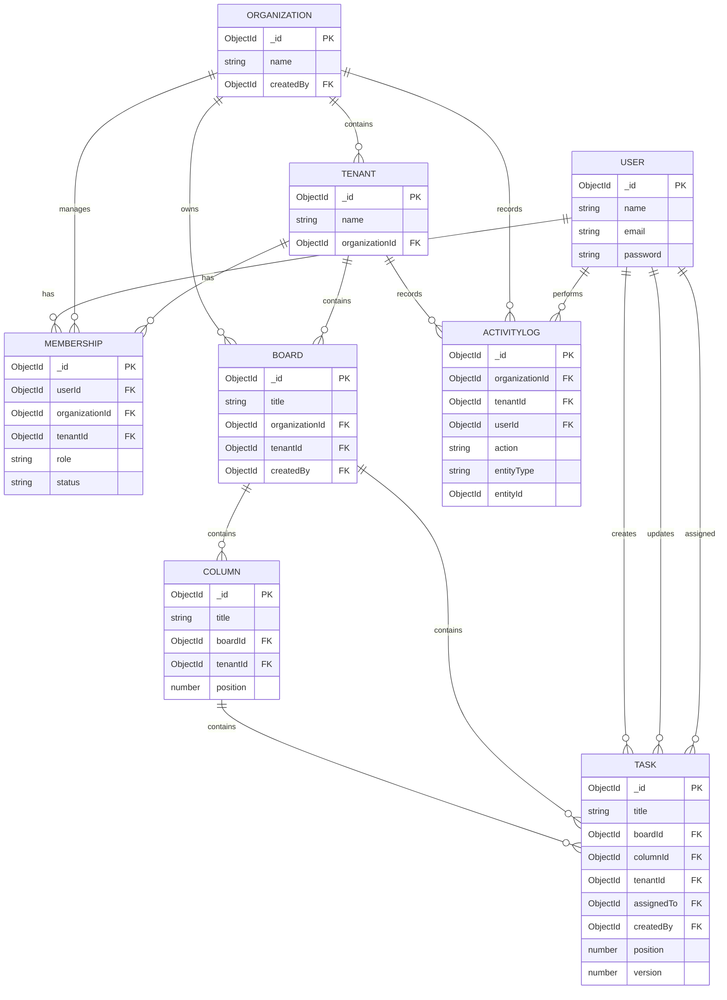

# SyncBoard – Entity Relationship Diagram

## Database Collections

SyncBoard uses MongoDB with the following collections:

1. User
2. Organization
3. Tenant
4. Membership
5. Board
6. Column
7. Task
8. ActivityLog

## ER Diagram

## Relationship Explanation

- One organization can contain multiple tenants.
- One user can have multiple memberships.
- Membership defines the user's role and access status.
- One tenant can contain multiple boards.
- One board can contain multiple columns and tasks.
- One column can contain multiple tasks.
- Tasks can be assigned to users.
- Activity logs record actions performed within a tenant.

## Multi-Tenant Isolation

Every tenant-specific board, column and task is associated with a `tenantId`.

The backend validates tenant membership before allowing access to tenant data.
